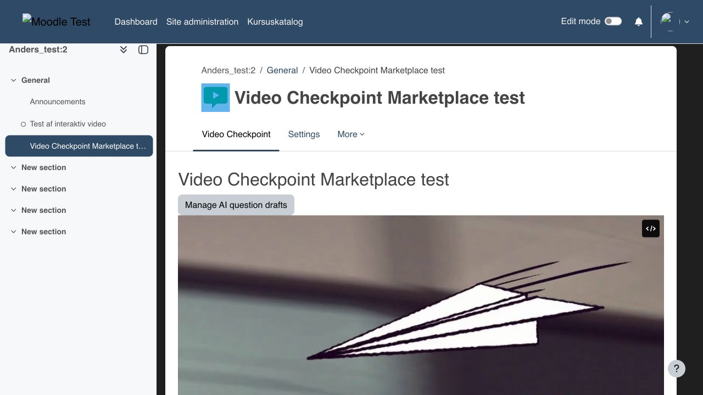
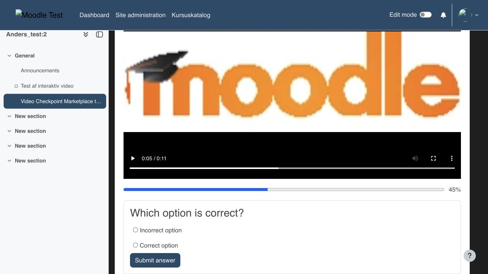
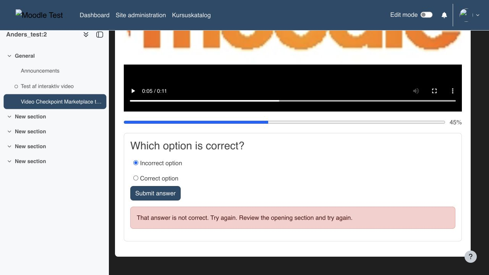
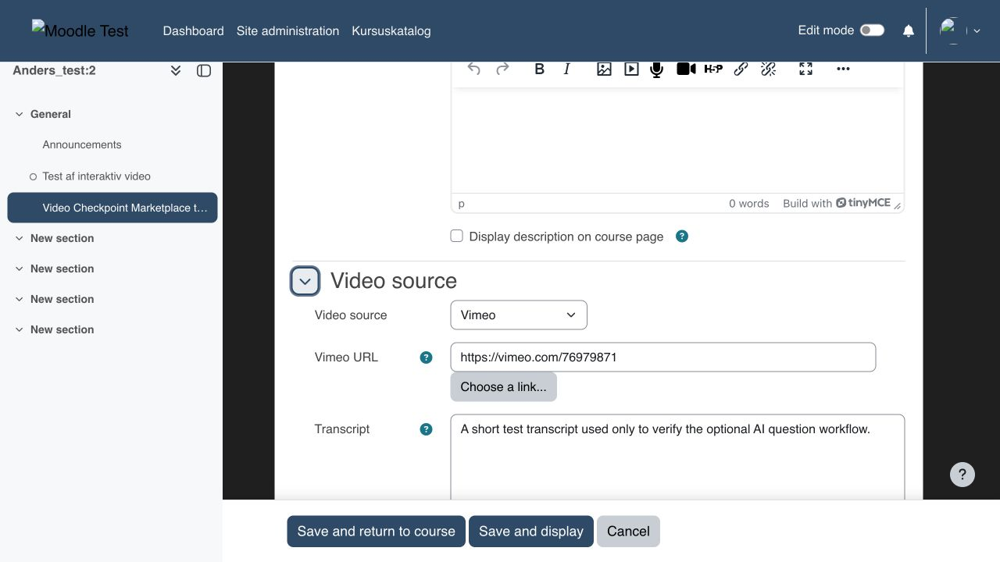
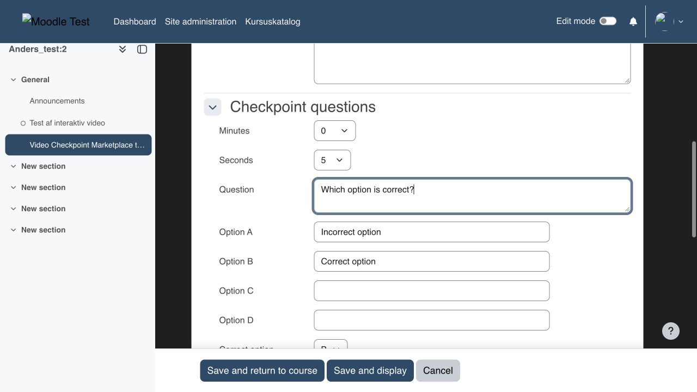
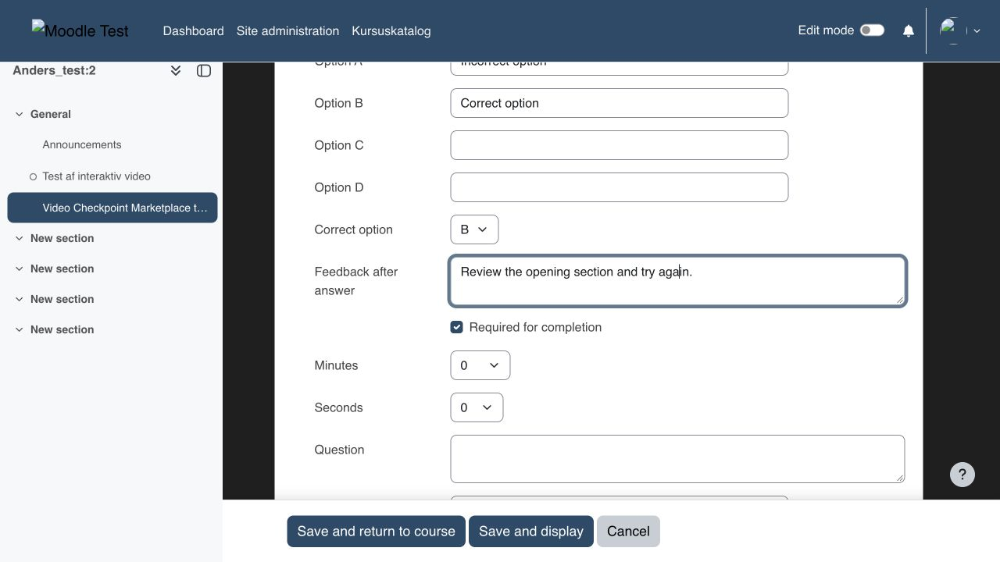

# Video Checkpoint for Moodle

Video Checkpoint (`mod_videocheckpoint`) is a Moodle 5.2 activity module for creating interactive learning videos from
an uploaded MP4 file or a Vimeo video.

## Features

- Upload one MP4 file to Moodle or provide a Vimeo URL.
- Add multiple-choice checkpoints at selected minutes and seconds.
- Pause playback and require a correct answer at mandatory checkpoints.
- Show feedback after correct and incorrect answers.
- Track unique watched intervals on the server instead of trusting the furthest playback position.
- Use watched percentage and mandatory questions as Moodle activity-completion conditions.
- Send grades to the Moodle gradebook.
- Generate draft checkpoint questions through Moodle's configured AI subsystem.
- Back up and restore settings, questions and uploaded video.
- Export and delete learner data through Moodle's Privacy API.

AI-generated questions are always saved as unpublished drafts. A teacher must review and publish them before learners
can see them.

## Requirements

- Moodle 5.2 or later.
- A browser-compatible MP4 file, or a Vimeo video that permits embedding on the Moodle site's domain.
- An AI provider configured by the Moodle administrator is optional and is required only for AI question generation.

## Installation

1. Download the release ZIP.
2. Extract it into `mod/videocheckpoint` in the Moodle installation.
3. Sign in as an administrator and visit **Site administration > Notifications**.
4. Complete the database installation.

Alternatively, install the ZIP through **Site administration > Plugins > Install plugins**.

## Configuration and use

1. Add a **Video Checkpoint** activity to a course.
2. Select **Upload to Moodle** or **Vimeo** as the video source.
3. Add checkpoint questions and choose their minute and second positions.
4. Configure the watched-percentage and mandatory-question completion conditions as needed.
5. Save the activity and test the complete learner journey.

For Vimeo, the learner's browser connects directly to Vimeo. Vimeo may process technical and usage data according to
the site's Vimeo agreement and privacy notice. When AI generation is requested, the transcript and generation
instructions are sent through the AI provider configured in Moodle.

## Screenshots

### Learner video player

### Checkpoint question

### Feedback after an incorrect answer

### Teacher settings

## Privacy and data

The plugin stores watched intervals, calculated progress and submitted checkpoint answers. It implements Moodle's
Privacy API for data export and deletion. Uploaded video remains in Moodle's File API. Vimeo videos remain hosted by
Vimeo.

## Limitations

- YouTube is not supported in this release.
- Moodle App offline playback is not supported.
- Uploaded video uses Moodle file delivery; large-scale deployments should configure their web server and storage for
  the expected media traffic.

## Support and reporting issues

Use the issue tracker associated with the public source repository. Do not include personal data, access tokens or
private video URLs in issue reports.

## License

Copyright 2026 Simple Solutions.

This plugin is licensed under the GNU GPL v3 or later. See `LICENSE`.
